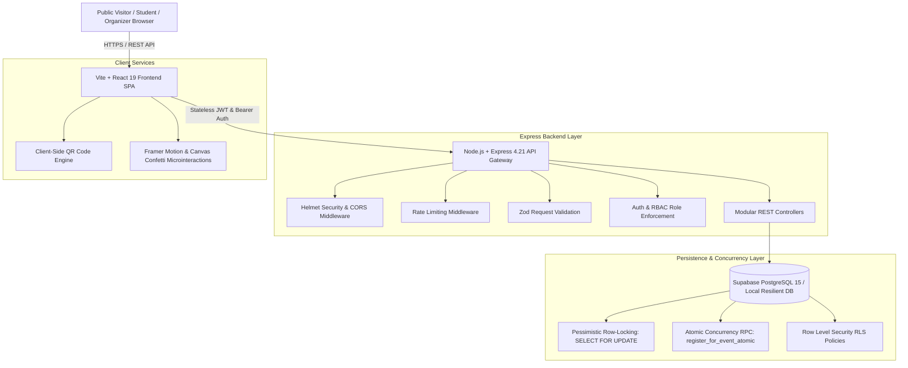

# 1Kampus — System Architecture & Design Document

1Kampus is an enterprise-grade full-stack event discovery, seat reservation, and attendance tracking platform built for the **ACM Student Chapter SRMIST Web Development Recruitment Assessment** and personal portfolio.

---

## 1. High-Level System Architecture

---

## 2. Core Architectural Pillars

### A. Strict Concurrency-Safe Seat Reservations
To prevent double-booking or exceeding event capacity during high-traffic hackathon registrations (e.g. 500 students claiming the final available seat simultaneously), 1Kampus uses a pessimistic row-level locking strategy:
1. When a registration is initiated, the backend issues `SELECT * FROM events WHERE id = p_event_id FOR UPDATE`.
2. The event row is locked exclusively in the database transaction.
3. The procedure verifies that the event is `published`, the registration deadline hasn't elapsed, and the start time is in the future.
4. It queries active confirmed registrations (`SELECT COUNT(*) ... WHERE registration_status = 'confirmed'`).
5. If `count >= capacity`, the transaction is rolled back with an immediate `409 CAPACITY_EXCEEDED` error.
6. A partial unique index `(user_id, event_id) WHERE registration_status = 'confirmed'` ensures no student can obtain duplicate active seats even on concurrent double-clicks.
7. The registration is committed and a unique cryptographic ticket code (e.g., `1K-HACK-7F3A91`) is issued.

### B. Role-Based Access Control (RBAC)
1Kampus enforces three distinct user security tiers:
- **Student**: Can browse events, search and filter, register for open events, view personal registered tickets and QR codes, cancel own registrations, and edit personal display profile.
- **Organizer**: Includes all student capabilities plus the ability to create/edit own events, manage venue capacity quotas, view real-time participant rosters, export attendee lists to CSV, and scan/verify QR codes at venue admission desks.
- **Admin**: Platform moderator with full event moderation rights (Draft, Published, Cancelled, Completed), user directory monitoring, and system-wide telemetry.

---

## 3. Database Schema Design

### `profiles`
- `id` (UUID, Primary Key)
- `full_name` (TEXT)
- `email` (TEXT, Unique)
- `role` ('student' | 'organizer' | 'admin')
- `avatar_url` (TEXT)
- `created_at`, `updated_at` (TIMESTAMPTZ)

### `events`
- `id` (UUID, Primary Key)
- `organizer_id` (UUID, FK -> profiles.id)
- `organizer_name` (TEXT)
- `title` (TEXT)
- `slug` (TEXT, Unique)
- `description` (TEXT)
- `category` ('Technology' | 'Hackathons' | 'Workshops' | 'Cultural' | 'Entrepreneurship' | 'Sports' | 'Talks')
- `banner_url` (TEXT)
- `venue` (TEXT)
- `start_time`, `end_time`, `registration_deadline` (TIMESTAMPTZ)
- `capacity` (INTEGER > 0)
- `status` ('draft' | 'published' | 'cancelled' | 'completed')
- `instructions` (TEXT)
- `created_at`, `updated_at` (TIMESTAMPTZ)

### `registrations`
- `id` (UUID, Primary Key)
- `user_id` (UUID, FK -> profiles.id)
- `event_id` (UUID, FK -> events.id)
- `registration_status` ('confirmed' | 'cancelled' | 'waitlist')
- `ticket_code` (TEXT, Unique)
- `attendance_status` ('unmarked' | 'attended' | 'absent')
- `registered_at`, `cancelled_at`, `attended_at` (TIMESTAMPTZ)
- Unique partial index on `(user_id, event_id)` where `registration_status = 'confirmed'`.
